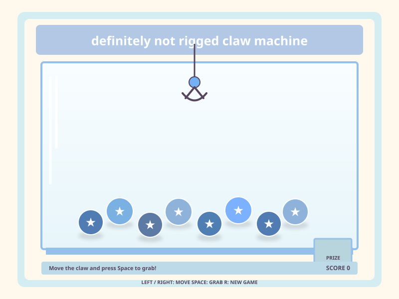
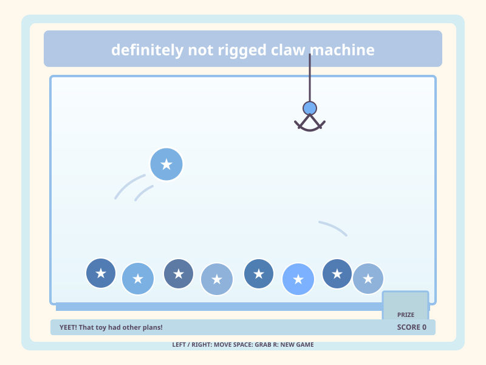

# Definitely Not Rigged Claw Machine

A small claw machine game made with Python and Tkinter. Move the claw, try to
pick up a toy, and get it to the prize chute. Sometimes the machine throws a
toy instead.

## Screenshot





## Install and play (Windows)

These steps assume you have never used Python before. You do not need to learn
Python or type any Python code to play.

### 1. Install Python

1. Click [Download Python](https://www.python.org/downloads/) and download the
   latest Python 3 release for Windows.
2. Open the downloaded file. In the installer, check **Add python.exe to PATH**
   near the bottom of the first screen.
3. Click **Install Now** and wait for setup to finish. If Windows asks whether
   to allow the installer to make changes, choose **Yes**.

### 2. Find the game folder

The game is the folder named `python_game`. It must contain the file `main.py`.
If you are looking at this README in your project, open that `python_game`
folder in File Explorer.

### 3. Open a command window in that folder

1. In File Explorer, open the `python_game` folder (the one containing
   `main.py`).
2. At the very top of the File Explorer window, find the long box showing where
   you are. It may say something like `This PC > ... > python_game`. Click that
   box once. The words should turn into a folder path, such as
   `C:\Users\YourName\...\python_game`.
3. Type `powershell` (this replaces the path in the box) and press **Enter**.
   A blue or black command window opens already pointed at the game folder.

### 4. Start the game

In that command window, type this line and press **Enter**:

```text
py main.py
```

A window titled **Ur Not Gonna Win** should appear. Leave the command window
open while you play. Close the game window when you are done.

## Playing

- Hold **Left Arrow** or **Right Arrow** to move the claw over the toys.
- Press **Space** to lower the claw and try to pick up a toy.
- Each toy delivered to the chute earns one point.
- Every completed claw attempt earns **3 coins**, even if the claw misses or
  throws the toy. Your coin total appears beside your score.
- Press **S** between rounds to open the prize shop. Press **1**, **2**, or
  **3** to buy an item, then **S** or **Esc** to close the shop. Bought items
  are added to your in-game collection.
- Press **R** to start a new game and reset your score.

## If it does not start

- If you see **'py' is not recognized**, install Python again and make sure
  **Add python.exe to PATH** is checked, then close and reopen the command
  window.
- If the command window says it cannot find `main.py`, you opened the wrong
  folder. Go back to File Explorer and open the `python_game` folder that
  contains `main.py`, then repeat step 3.
- If a Python or Tkinter error appears, copy the full error text and ask for
  help. Tkinter is normally included with the Windows Python installer, so
  there is no separate game package to install.

## macOS or Linux

Install Python 3 from [python.org](https://www.python.org/downloads/), then
open a Terminal in the `python_game` folder and run `python3 main.py`. On some
Linux systems Tkinter is a separate package; for Debian or Ubuntu, run
`sudo apt install python3-tk` in Terminal first.

## Controls

- **Left / Right arrows**: move the claw while it is at the top
- **Space**: lower the claw and try to grab the nearest prize
- **S**: open the shop between rounds; **1 / 2 / 3** buys a listed item
- If the claw picks up a prize, there is a 30% chance it throws it back into
  the machine instead.
- **R**: start a fresh game

Each prize delivered to the chute adds one point to your score.
